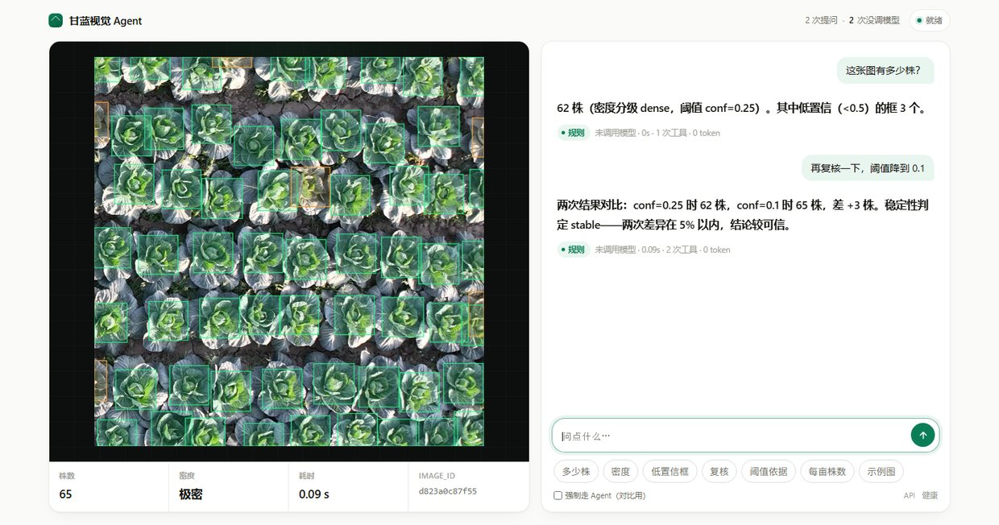

# cabbage-vision-agent

把甘蓝航拍检测封装成**可编排的视觉 Agent**：自然语言提问进，带依据的计数结论出。

检测模型来自 [cabbage-detection](https://github.com/3086-x/cabbage-detection)（YOLOv11n，单类，mAP50-95 0.970）。
那个仓库回答"用哪个结构"，这个仓库回答另一个问题：

> **模型能力怎么变成 Agent 能可靠调用、且在出错时能自我纠正的工具？**

能跑通 YOLO 的人很多，能说清工具契约、错误语义、上下文预算的人不多。这个项目只做后者。

---

## 一次运行

问：*这张图里有多少株甘蓝？长势密不密？*

```
[1] detect_cabbage  ✓  54ms   count=49  density=moderate  n_low=2
[2] refine_detection ✓  31ms   49 → 50  (conf 0.25 → 0.15)  stability=stable
```

回答：*该图共 50 株，密度 moderate。conf=0.25 时检出 49 株，降到 0.15 后为 50 株
（差 +1，稳定性 stable）。结论取复核后的计数。*

> **这条轨迹由离线 provider（`--provider mock`）驱动**。两次工具调用都真实执行在
> GPU 上，株数是真的；但"发现 2 个低置信框后决定降阈值复核"这一步是脚本策略，
> 不是模型判断。接入真实模型后的记录会替换这里——在那之前，这个仓库证明的是
> **工具契约与循环工程可用**，而不是模型选工具的水平。

完整轨迹见 [examples/transcript_single_image.md](examples/transcript_single_image.md)。

第二行是整个设计的落点：`detect_cabbage` 返回 `n_low=2`，说明有两个框置信度低于
0.5，计数可能不稳。`refine_detection` 让"要不要复核"成为一个可执行的决策，
而不是开发者写死的流程。

---

## 四个设计决策

这四件事决定了它是 Agent 而不是 API wrapper。

### 1 工具返回证据，不返回图片

一张标注图对 LLM 毫无意义——它没法从红色方框里数出数值。所以工具返回结构化观测：

```json
{
  "count": 49, "density": "moderate", "coverage": 0.448,
  "conf_stats": {"min": 0.31, "median": 0.82, "max": 0.874, "n_low": 2},
  "box_size_px": {"w_median": 103.7, "h_median": 104.1},
  "grid": {"n": 4, "counts": [[2,3,2,3],[5,3,3,3],[4,3,3,3],[4,3,3,2]],
           "empty_cells": 0, "empty_if_random": 0.7, "vmr": 0.18,
           "pattern": "比随机更规则"},
  "boxes_head": [[977.2, 47.8, 93.6, 95.6, 0.874], ...],
  "image_id": "b5d3658e433e"
}
```

`n_low` 是关键字段：它把"这个计数有多可信"变成了模型可读的信号。
没有它，模型只能照抄数字。

`grid` 是同一个道理，只不过补的是另一种缺口。"分布得均匀吗"这个问题，
在只有 `boxes_head`（前 3 个框）的时候没有答案可给——模型于是自己造了一张
4×4 表，16 个数字配着"左侧中部 2 株"的方位描述，全是编的（实测发生过一次）。
给它真的 `grid` 之后，同一道题从 85 s / 4974 token 降到 10.2 s / 539 token，
因为数字不用"想"。`counts` 求和恒等于 `count`，用户自己就能核。

### 2 错误是输入，不是异常

工具永不抛异常，失败一律变成结构化观测：

| code | retryable | 模型该怎么做 |
|---|---|---|
| `INVALID_ARG` | ✓ | 改参数重试，不用换图 |
| `NO_DETECTION` | ✓ | 阈值过高，降到 0.10 再试一次 |
| `IMAGE_NOT_FOUND` | ✗ | 路径错了，重试无意义，直接告知用户 |
| `UNSUPPORTED_FORMAT` | ✗ | 格式不支持，告知用户转 jpg |
| `ENGINE_OOM` | ✗ | 显存不足，建议换 CPU |

`retryable` + `hint` 两个字段让自纠正变成可能。人类预设的重试策略在真实任务里
经常比模型差，所以循环层**不拦截错误**，只负责把错误原样送进上下文。

### 3 阈值是参数，不是常量

`conf` 暴露在工具签名里，而不是写死在代码里。这让"要不要复核"成为模型的决策，
而不是开发者的硬编码。`refine_detection` 复用缓存，复核只要 31ms。

### 4 观测有预算

单次工具返回限制 1400 字符（`detail=full` 的检测放宽到 7000）。超预算时
砍掉长列表、保留结论字段，并显式告知 `truncated: true` —— 让模型知道信息不全，
而不是默默拿到半截数据。

历史超过 6 条观测时，旧观测替换成一行摘要。**只替换 content，不动结构**——
删消息会破坏 `tool_call_id` 配对，多数供应商直接返回 400。

---

## 快速开始

```bash
git clone https://github.com/3086-x/cabbage-vision-agent.git
cd cabbage-vision-agent
pip install -e .

# 权重 5.5MB，不走 Git 历史，从 Release 下载
curl -L -o weights/best.pt \
  https://github.com/3086-x/cabbage-vision-agent/releases/download/v0.1.0/best.pt

export DASHSCOPE_API_KEY=sk-xxx        # 或 OPENAI_API_KEY / DEEPSEEK_API_KEY
cvagent models --provider dashscope    # 先看哪些模型能用、哪些支持工具调用
cvagent doctor --probe                 # 自检：权重、torch、工具、LLM
cvagent ask "这张图有多少株甘蓝？" --image path/to/img.jpg --model qwen3.8-flash
```

### 一键 demo（无 API Key）

想先看它跑起来，再用真实模型：

```bash
python scripts/demo.py          # 真实检测 + 脚本化决策，约 30s（首次含模型加载）
python scripts/demo.py --image path/to/img.jpg --device cpu
```

脚本会真实加载 `weights/best.pt`、执行 `detect_cabbage` → `refine_detection`，
把轨迹写到 `runs/demo/trajectory.json`，并用退出码表示成败（0 通过 / 2 无有效株数）。
它证明的是工具契约与循环工程可用；模型选工具的水平要靠后面的真实 provider 评测。

**模型名必须确认，这坑很常见。** 百炼等平台的免费额度是**按模型分别发放**的：
同一个 key，`qwen3.8-flash` 有额度、`qwen-plus` 可能已经用尽。所以
`403 quota_free_tier_only` 通常不是 key 无效，而是**这个模型的额度没了**。
`cvagent models` 一次列出每个模型的对话能力、工具调用能力和失败原因：

```
模型                        对话    工具调用    备注
qwen3.8-flash             ✓     ✓       {"image_path": "/tmp/a.jpg"}
qwen-plus                 ✗     -       quota_free_tier_only 免费额度已用尽…
```

**没有 API key 也能完整跑通决策链**：

```bash
cvagent ask "这张图有多少株？" --image img.jpg --provider mock
```

`mock` 是脚本化 provider，按固定策略驱动工具。它的作用不是"假装有 LLM"，
而是让**决策链本身可测试**——工具契约、错误传播、观测截断、循环终止，
这些逻辑与模型无关，不该等到接上模型才能验证。

### 流式输出与会话记忆

```bash
# 先看到字，工具行随后；结束后仍会打印完整结论与开销
cvagent ask "这张图有多少株？" --image img.jpg --stream

# 同一会话的第二问会自动带上上一轮的结论与株数
cvagent ask "那密度算高吗？" --image img.jpg --session field
cvagent ask "换一块地" --image img2.jpg --session field --new-session
```

会话只存「问题 + 结论 + 株数 + 图名」，不存完整 messages：既省 token，也避免旧
`tool_call_id` 在新请求里失效。历史取最近 3 轮、硬上限 1200 字，落在
`runs/sessions/<name>.json`；文件损坏会备份为 `.bak-<时间戳>` 后当新会话继续。

### 供应商报错怎么读

`doctor --probe` 和 `ask` 会把供应商的原始错误码归一化，并附一句能照做的建议。
这几种最常见：

| 看到 | 实际含义 | 怎么办 |
|---|---|---|
| `[quota_free_tier_only]` | 免费额度用尽，且账户处于「仅用免费额度」模式 | 控制台关掉该开关并充值；**重试没有用**，所以不会自动重试 |
| `[invalid_api_key]` | Key 无效或已删除 | 检查环境变量里是否粘进了空格/换行 |
| `[rate_limited]` | 触发限流 | 等几秒或降并发。额度耗尽的账户也可能持续报此码 |
| `[access_denied]` | 该模型未开通 | 先在控制台开通对应模型 |
| `[model_not_found]` | 模型名不存在/该区域未上线 | `--model` 换一个 |

---

## 界面

命令行能证明「能力存在」，证明不了「产品存在」。所以有 `serve`：



```bash
pip install -e '.[web]'
cvagent serve --port 8000 --model qwen3.8-27b
#                     ↑ 默认模型没额度时换一个；首次启动预热权重，CUDA 约 30s
```

左边拖图，右边提问。界面上每个回答底下都挂着一行小字：

```
[规则] 未调用模型 · 0.09s · 1 次工具 · 0 token
[Agent] qwen3.8-27b · 85.2s · 1 次工具 · 6554 in / 4974 out
         升级原因：措辞不在规则覆盖范围内
```

这行字是这个项目唯一值得放到产品里的东西。**分层如果不是运行时可见的，
它就只是一句架构描述**——用户看到"62 株"时无法判断这个数字是规则算出来的，
还是模型看完工具返回后随口写的。把 route、升级原因、每一步工具调用摊在答案
旁边，才让"可验证"从 README 的形容词变成界面上的一行事实。

几个刻意的做法：

- **路径不下发给前端。** `pipeline.extract()` 会用正则从问题文本里抽绝对路径
  去读盘。如果前端能把路径写进问题，这个能力就是一次任意文件读取。所以上传
  只返回 `image_id`，真实路径留在服务端映射表；用户自己写的路径在拼接前先被
  抹掉，只有服务端注入的那一条能进工具参数。
- **框按置信度分色。** 答案里写"其中 3 个低置信框"，图上就用橙色标出那 3 个，
  其余绿色。框不是从工具返回里取的——`detect_cabbage` 默认只给前 3 个框（模型的
  上下文预算），界面要的是全部，所以直接从 engine 缓存取，零额外推理，也保证
  「画出来的框数」与「答案里的株数」出自同一份数据。
- **SSE 而不是等一个完整的 JSON。** 规则路径 0.1s 无所谓，Agent 路径几十秒，
  没有中间态用户会以为卡死。事件分四种：`route`（决定升级）、`step`（一次工具
  调用结束）、`delta`（模型吐字）、`done`。
- **推理串行，但等 LLM 不占锁。** 只有一张 GPU，同一个 model 并发 predict 会
  互相踩显存；但 Agent 等模型的几十秒不该堵住下一个人。锁只包 `dispatch`。
- **模型挂了服务不挂。** 权重加载失败时页面照常打开，只是顶栏标红——命中的
  规则路径仍然可用。这是分层的副产品：LLM 不可用，确定性那半条腿还能走路。

```
POST /api/upload        图片 → image_id（按内容指纹去重）
POST /api/ask           同步问答，返回答案 + 路由 + 完整轨迹 + 框
POST /api/ask/stream    SSE，同上但分事件推送
GET  /api/health        模型是否就绪、设备、预热耗时
```

> 延迟是真的，而且取决于工具给没给够数据。同一个"分布得均匀吗"：补 `grid`
> 字段之前，qwen3.8-27b 要 **85s / 4974 个 completion token**（大部分是它在凭空
> 推一张网格表）；补上之后 **10.2s / 539 token**，因为数字不用"想"，读出来就行。
> 能规则化的问题也不该付 LLM 的钱和时间——这条路径的答案是 0.1s 的。

---

## 工具

| 工具 | 何时调用 | 返回 |
|---|---|---|
| `inspect_image` | 先判断图能不能用（太暗/太糊/过小） | 尺寸、格式、亮度、边缘强度 |
| `detect_cabbage` | 要株数 + 密度 + 置信度分布 + 空间分布 | 统计 + 4×4 网格 + 前 3 个框（或全量） |
| `count_cabbage` | 只要一个数字，要最省 token | 株数、密度、低置信框数 |
| `refine_detection` | 低置信框多，或用户质疑准确性 | 两次阈值对比 + 稳定性判定 |
| `batch_detect` | 给的是文件夹 | 总数、均值、极值、逐文件 |
| `search_docs` | 问口径、依据、局限（为什么这个阈值、怎么分级、能否换算） | 带 `path#heading` 出处的知识库片段 |

`detect_cabbage` 的 `grid` 把画面均分成 n×n（默认 4，可调 2~8），按**框中心点**
归属，所以 `counts` 求和恒等于 `count`——用户拿总株数一加就能核对。均匀度看
`vmr`（方差均值比，随机分布 = 1），不看变异系数：后者随格子数漂，同一张图
4×4 时 0.30、6×6 时 0.52，一套阈值会把"格子变小"误判成"分布变差"。口径、
实测范围（30 张图 VMR 全部 < 1，一张"聚集"都没有）和不能说的结论都在
`docs/knowledge/spatial.md`。

`cvagent tools --json` 输出完整 JSON Schema。

---

## 可验证性

```bash
python -m unittest discover -s tests    # 153 个测试，约 2 秒
python -m pytest -q                     # 160 条（含 7 条 pytest 风格的检索契约）
```

测试**不加载权重、不联网**，在任何机器上都能跑。覆盖的是契约而非模型行为：

- 未知工具 / 缺参数 / 参数越界 / 非法 JSON → 返回正确的 `code` 且不抛异常
- 扩展名是 `.jpg` 但内容是文本 → 靠魔术字节抓住，且在模型加载前就失败
- `detail=full` 超预算 → 保留 `count`，砍掉 `boxes`，标记 `truncated`
- 步数打满 → 不强杀，发一次不带 tools 的请求逼出结论，`stopped_reason=max_steps`
- 历史压缩 → 所有 `tool_call_id` 保持配对，最新一条观测保持完整
- 高阈值命中低阈值缓存 → 必须按本次阈值过滤框，不能把 0.15 的结果当成 0.25 的

## 评测（工具用得对不对）

契约测试证明工具写对了，这里证明模型会用。这两件事不能混：

```bash
python eval/run_eval.py --provider mock                    # 自检管线，不需要 key
python eval/run_eval.py --provider dashscope --model qwen3.8-27b
```

29 条任务、8 类场景（基础/模糊/复核/批量/不可用图/错误恢复/越界/空间分布）。
判定分五层，全部基于轨迹的机器可检事实，不用 LLM-as-judge：

| 层 | 抓什么问题 |
|---|---|
| 工具 | 该调 `count` 却调了 `detect` |
| 轮次 | 简单问题绕 5 轮；两张图只处理一张 |
| 参数 | conf 没真降下去；声称给全部坐标却用了 `summary` |
| 答案 | 断言"没得病"；给出每亩株数 |
| 覆盖 | 多图任务只处理了一张就下结论 |

幻觉用**数字溯源**判：回答里每个数字都必须能在某次观测里找到（允许差值、
百分比、单位换算等派生）。不靠判官打分，所以同一份轨迹重跑分数不变。

### 实测（29 条全跑）

| 模型 | 通过率 | 工具选择 | 错误恢复 | 幻觉率 | 平均轮次 |
|---|---|---|---|---|---|
| `qwen3.8-27b` | 100%（28/28 计入） | 100% | 100% | **0%** | 1.68 |
| `deepseek-v4-pro-0813` | 97%（28/29） | 100% | 100% | **0%** | 1.59 |

qwen 那次 S3（缺苗率）跑到一半被供应商免费额度打断，记为环境故障、不计入分母，
所以是 28/28 而不是 29/29；同日 qwen 的额度就已耗尽，无法补跑。deepseek 那次
唯一失败的是 B3（「这张图是不是拍糊了」）——`inspect_image → search_docs ×3`，
4 次调用超出 2 轮预算，扣的是效率不是正确性。

26 条时代 `qwen3.8-27b` 跑过两次，分别是 96%（25/26）和 92%（24/26），失败的
都是 A4/F2 这类**绕路超预算**。所以这个任务集上的分数有 ±4pp 的漂移，看单次
胜负没有意义，要看失败落在哪一层。

`mock` 的 42% 不能当模型能力看——它是按脚本行动的替身，不读问题。跑它的
用处是反向验证判定没有过松：如果 mock 全过，说明约束写虚了。

细节与指标的完整定义见 [eval/README.md](eval/README.md)。

### 对照：确定性管线 vs Agent

有一部分请求根本不需要循环。为了量出这条边界，加了一条零 LLM 的确定性路径
（`src/cvagent/pipeline.py`：正则路由意图 → 固定动作 → 模板作答），用同一个
`run_eval.py`、同一套判据跑对照。

|  | 主任务集 26 条 | **留出集 8 条（换措辞，规则没参考过）** | 全量 29 条（同一模型 `deepseek`） | 零 LLM 占比 | 延迟中位 |
|---|---|---|---|---|---|
| 确定性管线 | 100% | **38%** | 90%（26/29） | 100% | **0.13 s** |
| Agent | 92% | **88%** | 97%（28/29） | 0% | 11.64 s |
| **分层（默认路径）** | **100%** | **88%** | **100%（29/29）** | **85% / 38% / 79%** | 规则 0.14 s |

29 条那列是同一模型下的三方对照：纯管线 26/29（缺的正是 S1–S3，规则层不接），
纯 Agent 28/29（B3 绕路超预算），分层 29/29——23 条走规则、6 条升级。
**分层没有低于任何一侧，而 79% 的请求一次 LLM 都没调。**

26 条的 100% 是**过拟合**（规则是看着那批措辞写的），不能当能力指标。真数字是留出集：
管线掉到 38%，Agent 保持 88%，代价是 90 倍延迟。

但第三行才是结论：**分层的通过率不低于纯 Agent，而 85% 的请求一次 LLM 都没调。**
所以 `ask` 的默认行为就是分层——规则先跑，判断不了才升级：

```bash
cvagent ask "这张图有多少株？" --image img.jpg          # 命中规则：0 次 LLM，~0.1s
cvagent ask "大概几棵？" --image img.jpg                 # 认不出，自动升级到循环
cvagent ask "..." --mode pipeline                        # 只走规则，不升级（未命中退出码 4）
cvagent ask "..." --mode agent                           # 直接进循环，跳过规则
```

升级判据只有两条，都能从轨迹机械读出：路由未命中（`stopped_reason="pipeline_unrouted"`），
或某个工具返回 `retryable=true` 的错误。**故意没加**「检出 0 株 / 置信度双峰 / 图质量低」
这类业务判断——那会让升级率失控，而且没有证据说明 Agent 在这几种情况下更好。

两种失败不在同一层：**管线死在语言**（「几棵」不是「几株」、「头 5 张」不是「前 5 张」），
**Agent 死在决策**（多调一次工具、绕路超预算、遇"对焦跑了"仍顺手检测一遍）。
前者需要语言模型，后者需要更紧的提示，不能互相替代。
完整实验、逐条失败原因与复现命令见 [docs/PIPELINE.md](docs/PIPELINE.md)。

**跑一次要花多少**：每次请求的固定开销约 2400 token（系统提示 + 6 个工具 schema），
29 条任务按平均 2.5 次请求算，全量约 17 万输入 token。按 qwen-plus 的
0.8 元/百万 token 计，**一次全量评测约 0.2 元**；调阈值阶段先 `--limit 3` 冒烟，
一条不到一分钱。确定性管线那一组是 0 元。

---

## 结构

```
src/cvagent/
├─ vision/     纯推理，不感知 LLM。懒加载、先校验后推理、按 image_id 缓存
├─ tools/      工具契约与分发。参数校验、错误转 payload、观测截断
├─ llm/        供应商抽象。base 定义 Message/ToolCall/Completion；
│              openai_compat 收敛所有协议差异；mock 提供离线驱动
├─ agent/      规划-执行-观察循环，含步数收束与历史压缩
├─ pipeline.py 零 LLM 的确定性路径：规则路由 + 固定动作 + 模板作答；
│              同时给出升级判据（escalate_reason）与交接文本（handoff）
├─ serve.py    把上面这些接成 Web 服务：上传隔离、SSE、分层标注、降级
├─ web/        单页前端。无构建、无框架，一个 HTML
├─ report.py   轨迹落盘（trajectory.json + report.md）
└─ cli.py      ask / detect / tools / doctor / models / setup-weights / replay / serve

eval/
├─ tasks.yaml          29 条任务，每条带期望工具序列与可机器判定的答案约束
├─ tasks_holdout.yaml  8 条换措辞的留出集，用于量规则的泛化半径
└─ run_eval.py         五层判定 + 数字溯源，输出 json 与 md 报告
```

不引 langchain。全部需求是"多轮消息 + function calling"，120 行客户端就够，
链式框架只会让可调试性变差。

---

## 与检测仓库的关系

```
cabbage-detection          ← 证明「为什么选 YOLOv11n、为什么不做注意力机制」
        │  结论被引用
        ▼
cabbage-vision-agent       ← 把这份视觉能力暴露成 Agent 可编排的工具
```

选型依据是那边的实测结论：注意力模块（SE/CBAM/CA）在三种子下均无可分辨增益，
所以这里**固定基线结构，把复杂度全部投入编排层**。两个仓库合起来讲的是一条
"证据驱动选型 → 应用落地"的链条，而不是两个孤立 demo。

两个仓库各有一个 `/` 页面，回答的是不同问题，不是重复建设：

| | 检测仓库 `src/serve/api.py` | 本仓库 `cvagent serve` |
|---|---|---|
| 后端 | ONNX Runtime（CPU，4 路并发） | PyTorch（CUDA，单路串行） |
| 页面做的事 | 拖图 → 出框 + 延迟分位 | 拖图 → 提问 → 带依据的结论 |
| 回答的问题 | 这个模型多快、多准、扛多少 QPS | 这个数字是怎么来的、谁算的 |
| 给谁用 | 压测、部署验证、给别的系统当推理 API | 人 |

推理没有走 HTTP 复用它，原因是 `refine_detection` 依赖「复用已解码结果、只改
阈值过滤」——同一进程内的缓存能免费做到，跨进程就要把整份检测结果序列化往返。
服务化的收益目前不抵这个复杂度；真要拆，接口已经在那边了（`POST /predict`）。

---

## 局限

- **密度分级是相对本数据集的**。训练集逐图株数四分位为 45/49/53，图来自同一块田，
  分布天然集中，`sparse/moderate/dense` 只有相对意义，不是农学绝对值。
  `very_dense` 的下界 65 不是四分位点，而是为离群图留的外推边界。
- **无法换算株/亩**。缺少地面标定（GSD），任何"每亩多少株"的说法都需要先做标定。
- **"分布均匀"是相对本图的**。`grid` 的坐标轴是裁出来的图像，图内均匀不等于田间
  均匀；缺苗率、株行距同样要地面标定，给不出。`vmr` 只在 30 张同源图上验过
  （全部 < 1，即都比随机撒点规整），没有另一种分布形态的真值可以对照——
  所以它现在只能回答"这批图之间谁更齐"，不能回答"这块地种得合不合格"。
  另外网格粒度会影响数字：n 变大时单位格株数变少，`mean_per_cell < 1.5` 时
  直接不给判断，因为那时抽样波动比信号大。
- **单类单场景**。只认甘蓝，只在这种航高与光照下验证过。
- **只测了两个模型，而且分数会漂**。`qwen3.8-27b` 在 26 条上两次运行分别是 96% 和 92%
  （A4 稳定失败，F2 在两次之间变化），温度设为 0 也不保证云端逐字复现。补跑 29 条时
  qwen 的免费额度中途耗尽（S3 记为环境故障），改用 `deepseek-v4-pro-0813` 才跑完
  纯 Agent 与分层两组。所以这些数字都是快照，不是区间。要当结论用需要
  多模型 × 多次运行，这还没做。
- **任务集是自拟的**。29 条覆盖了 8 类场景（补 `grid` 时加了 3 条空间分布），但问题写法
  由我设计，不代表真实用户的分布；它衡量的是"这些行为对不对"，不是"用户满不满意"。
- **确定性管线的 100% 是过拟合**。那 26 条的措辞就是写规则的参考，所以真实数字只能看
  8 条留出集（38%）。补了 3 条空间分布之后任务集变成 29 条，纯管线显示 90%（26/29）——
  缺的 3 条规则层**故意不接**（空间格局没有确定性动作），属于设计，不是回归。
  留出集本身也太小，一条任务值 12.5 个百分点，给不出置信区间。
  分层的 88% 同样只在这 8 条上成立，"不低于纯 Agent"这个结论不能外推。
  29 条上分层 100% vs 纯 Agent 97% 也只差一条任务，同样不能外推。
- **延迟不含冷启动**。0.13 s 是热进程内的单次检测，权重预热实测 28.8 s / 30.1 s
  （两次启动），不计入单次延迟；服务版把这 30 s 挪到启动阶段，所以还要再算上
  「服务起来之后、人还没打开页面」这段。分层的两个延迟中位数（规则 / 升级）
  算的不是同一批任务，不能用来比较"升级比直接跑慢多少"。
- **Web 层是单机的**。没有鉴权、没有限流，job 池只有 4 个 worker，上传映射表
  在内存里（重启即失效，最多留 32 张）。它是给人用的本机界面，不是多租户服务。
  上传目录 `runs/uploads/` 只做大小和魔术字节校验，不做病毒扫描。
- **两个前端不共用推理进程**。检测页走 ONNX/CPU，问答页走 PyTorch/CUDA，
  同一张图在两边可能有 1 帧级别的小差异（NMS 实现不同）。这不是 bug，
  但如果你拿两个页面互相校对数字，要知道它们不是同一条链路。


---

## 许可

MIT（仅覆盖代码与文档）。权重与数据集不随仓库分发。
